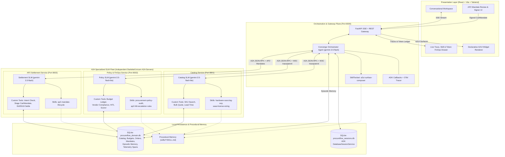
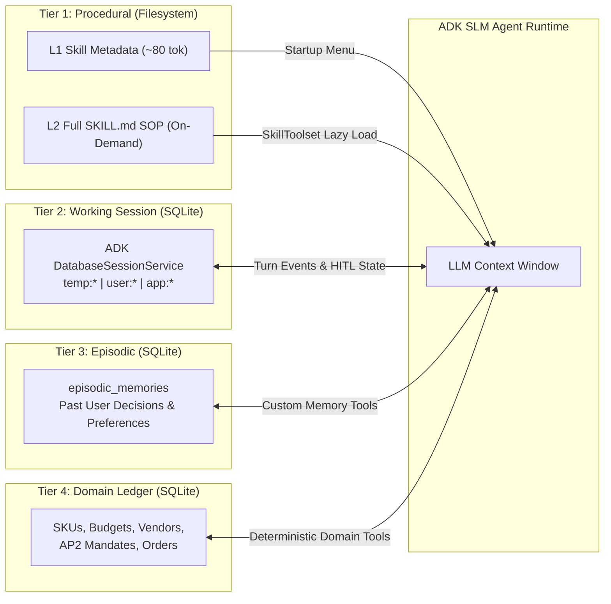
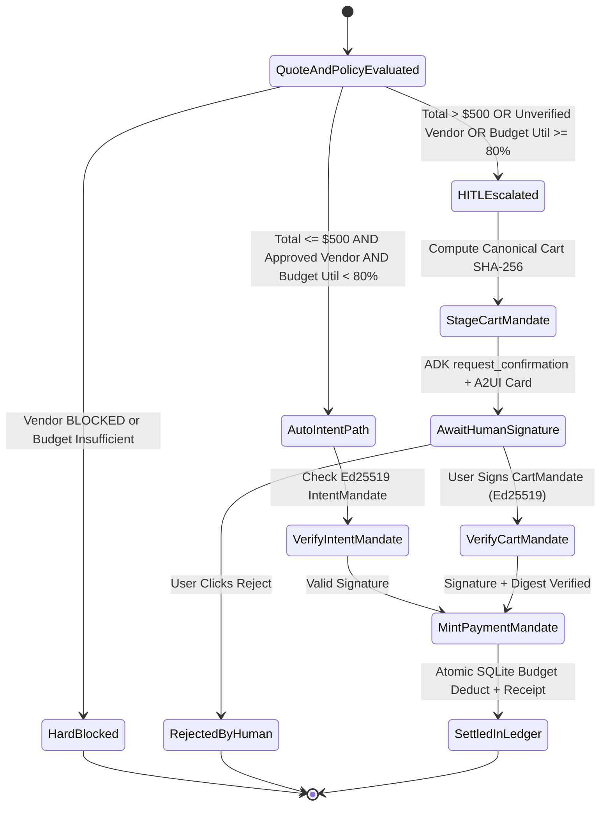
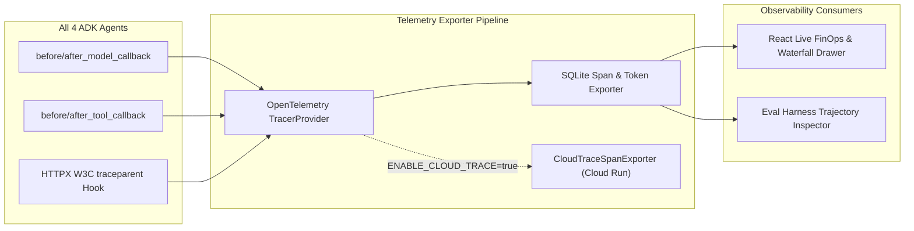
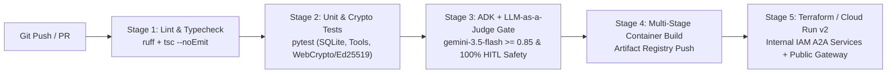

# ProcureFlow AI — System Architecture & Decision Records (`Architecture.md`)

**Project**: ProcureFlow AI — Autonomous Enterprise Procurement & Spend Desk  
**Framework & Protocols**: Google ADK (`2.15.0`), Gemini (`3.5-flash` & `3.5-flash-lite`), **A2A** (`a2a-sdk`), **A2UI**, **AP2 (Agent Payments Protocol)**, OpenTelemetry  
**Runtime**: Local-first (`uv` + Google Python `3.14` + SQLite + React/Vite) with full **Google Cloud Run v2** Terraform & CI/CD parity.

---

## 1. Executive Architecture Overview

**ProcureFlow AI** models an enterprise procurement desk where employees source hardware and software licenses through a conversational + generative UI concierge. Rather than using a monolithic prompt, the system decomposes intelligence across **four cooperating ADK agents** communicating over the **Agent-to-Agent (A2A)** protocol, backed by a **four-tier local memory architecture**, **cryptographic AP2 payment mandates**, **conditional Human-in-the-Loop (HITL)** governance, and **end-to-end token/span observability**.

---

## 2. Architecture Decision Records (ADRs)

### ADR-001: Multi-Agent Decomposition & Over-the-Wire A2A Protocol
- **Context**: A single agent overloaded with catalog pricing formulas, enterprise compliance rules, cryptographic AP2 mandate rules, and A2UI rendering schemas suffers from instruction dilution, higher latency, and higher token burn.
- **Decision**: Split responsibilities across **1 Coordinator (`gemini-3.5-flash`)** and **3 Specialized Task SLMs (`gemini-3.5-flash-lite` / `gemini-3.5-flash`)** exposed via ADK's `to_a2a()` (`/.well-known/agent.json` `AgentCard`) and consumed via `RemoteA2aAgent`. Use ADK `ParallelAgent` semantics for concurrent Catalog + Policy evaluation before Settlement.
- **Consequences**:
  - *Pros*: True service isolation, smaller prompts per SLM, parallel execution latency wins, and 1:1 deployability to independent Cloud Run microservices.
  - *Trade-off*: Requires distributed trace context (`traceparent`) propagation across HTTP hops so observability stays unified.

### ADR-002: Four-Tier Hybrid Memory (`skills/` Procedural + 3 SQLite Stores)
- **Context**: Agents need four fundamentally different kinds of state: (1) task SOPs/formulas, (2) active multi-turn conversation state, (3) cross-session user history, and (4) transactional domain records. Putting SOPs in SQLite or cramming all SOPs into static system prompts wastes context tokens.
- **Decision**:
  1. **Procedural Memory (`skills/*/SKILL.md`)**: Stored as version-controlled Markdown playbooks loaded lazily via ADK `SkillToolset(discovery_mode=SkillDiscoveryMode.LAZY)`. Agents see compact L1 metadata (~80 tokens/skill) at boot and pull full L2 SOP instructions only when needed.
  2. **Working / Session Memory (`procureflow_sessions.db`)**: Managed by ADK `DatabaseSessionService` (`sqlite+aiosqlite`) using scoped state prefixes (`temp:` turn quote data, `user:` profile/role, `app:` global policy thresholds).
  3. **Episodic Memory (`procureflow_domain.db` -> `episodic_memories`)**: Stores summarized past procurement episodes (e.g., preferred monitor brand, prior rejected vendors) queried via custom memory tools.
  4. **Semantic / Transactional Domain Store (`procureflow_domain.db`)**: Relational tables for `vendors`, `catalog_skus`, `department_budgets`, `ap2_mandates`, and `orders`.

### ADR-003: Pure-Python Custom ADK Tools (No 3rd-Party MCP Dependency)
- **Context**: External 3rd-party MCP servers introduce network flakiness, external credentials, and opaque failure modes in a self-contained local-first reference architecture.
- **Decision**: Implement deterministic, typed Python functions wrapped in ADK `FunctionTool` (with `ToolContext` access) scoped strictly to each agent's bounded domain. No agent shares tools with another agent; cross-domain data flows exclusively via A2A messages.

### ADR-004: Declarative A2UI Protocol Over Raw Markdown
- **Context**: Procurement decisions require comparing multi-attribute SKUs, inspecting department budget utilization gauges, and reviewing cryptographic payment mandates—tasks poorly served by walls of chat text.
- **Decision**: Standardize an **A2UI declarative JSON envelope** (`VendorComparisonCard`, `BudgetGaugeCard`, `AP2CartMandateApprovalCard`, `OrderReceiptCard`) governed by the `a2ui-surface-composer` skill and validated by Pydantic on the backend before streaming over SSE to native React + Tailwind components.

### ADR-005: Conditional HITL Governance with AP2 (Agent Payments Protocol)
- **Context**: Autonomous agents must never execute unbounded or out-of-policy financial spend, yet prompting humans for trivial pre-approved office supplies creates approval fatigue.
- **Decision**: Implement the **AP2 three-mandate verifiable chain** using real **Ed25519** digital signatures (`cryptography` library):
  - **`IntentMandate`**: Standing user/department authorization (`max_auto_usd = 500.00`, `allowed_tiers = ["PREFERRED", "APPROVED"]`, `max_budget_utilization = 0.80`).
  - **Autonomous Path**: When all three conditions hold, `ap2_settlement_agent` verifies the `IntentMandate` signature and directly mints a `PaymentMandate`.
  - **HITL Escalation Path**: If `total_usd > 500.00`, vendor is `UNVERIFIED`, or post-order budget utilization `>= 80%`, execution pauses via ADK `tool_context.request_confirmation()`, renders an `AP2CartMandateApprovalCard` containing a **SHA-256 canonical cart digest**, and requires an explicit human Ed25519 signature on the `CartMandate` before settlement can execute.
  - **Hard Block Path**: If vendor is `BLOCKED` or order exceeds 100% remaining department budget, policy rejects the transaction immediately without offering settlement.

### ADR-006: Full-Stack Observability, W3C A2A Context Propagation & Token FinOps
- **Context**: Multi-agent A2A systems can silently multiply token consumption and latency across sub-agents if only top-level chat responses are logged.
- **Decision**: Attach unified ADK callbacks (`before_model_callback`, `after_model_callback`, `before_tool_callback`, `after_tool_callback`) and OpenTelemetry spans to **all 4 agents**:
  - Extract `llm_response.usage_metadata` (`prompt_token_count`, `candidates_token_count`, `cached_content_token_count`, `total_token_count`) and compute real-time USD cost using model-specific pricing tables (`gemini-3.5-flash` vs `gemini-3.5-flash-lite`).
  - Inject W3C `traceparent` + `x-procureflow-session-id` headers on `RemoteA2aAgent` HTTP clients and extract them via ASGI middleware on every `to_a2a()` sub-server.
  - Persist spans and token rows locally to SQLite (`telemetry_spans`, `token_usage_ledger`) for instant inspection in the UI's **Observability & FinOps Drawer**, while supporting `CloudTraceSpanExporter` via environment toggle for Cloud Run.

### ADR-007: Dual-Layer Evaluation (`adk eval` Trajectory + LLM-as-a-Judge)
- **Context**: Exact string matching fails on conversational procurement responses, while pure LLM grading without deterministic guardrails can miss subtle security regressions (such as settling without a valid signature).
- **Decision**: Combine two complementary evaluation layers gated in CI:
  1. **Deterministic Invariants (`pytest` + ADK Trajectory)**: Assert exact tool/sub-agent routing sequences (`catalog_agent` + `policy_risk_agent` before `ap2_settlement_agent`), Pydantic A2UI payload validity, and cryptographic tamper rejection on AP2 mandates.
  2. **LLM-as-a-Judge (`evals/llm_judge.py`)**: Independent `gemini-3.5-flash` judge evaluating **5 atomic boolean rubrics** (`grounded_pricing`, `procedural_skill_adherence`, `ap2_hitl_safety`, `a2ui_completeness`, `session_memory_continuity`) across 6 golden scenarios, producing a structured JSON scorecard and enforcing `>= 0.85` overall rubric score + `100%` pass on `ap2_hitl_safety`.

### ADR-008: Local-First Execution with Production Cloud Run v2 & CI/CD Blueprint
- **Context**: This prototype runs locally without incurring cloud bills or requiring external payment gateways, yet must demonstrate production-ready GCP deployment architecture and automated CI/CD governance.
- **Decision**:
  - **Local Runtime**: Single supervisor command starts SQLite-backed A2A services (`8001–8003`), Gateway (`8000`), and Vite UI (`5173`), while `httpx.ASGITransport` powers fast, conflict-free automated tests.
  - **Cloud Run Reference IaC (`infra/terraform/`)**: Provisions 4 Cloud Run v2 services where the 3 A2A sub-agents enforce `INGRESS_TRAFFIC_INTERNAL_ONLY` and least-privilege `roles/run.invoker` IAM bindings solely for the Orchestrator service account, with secrets injected from Secret Manager.
  - **CI/CD Pipelines (`.github/workflows/ci-cd.yml` & `cloudbuild.yaml`)**: Enforce `ruff` -> `pytest` -> **LLM-as-a-Judge Eval Gate** -> multi-stage Docker build -> Artifact Registry push -> Cloud Run revision rollout.

---

## 3. Component & Port Matrix

| Service / Component | Port (Local) | Model Tier | Key Protocols | Primary Responsibility |
| :--- | :---: | :--- | :--- | :--- |
| **React + Vite UI** | `5173` | — | SSE, REST, A2UI, WebCrypto Ed25519 | Chat workspace, native A2UI widgets, client Ed25519 `CartMandate` signer, live Trace/Token Drawer |
| **Concierge Gateway & Orchestrator** | `8000` | `gemini-3.5-flash` | SSE, A2UI, A2A Client | Session state (`DatabaseSessionService`), episodic recall, parallel A2A fan-out, A2UI composition |
| **Catalog & Sourcing Agent** | `8001` | `gemini-3.5-flash-lite` | A2A Server (`to_a2a`) | SKU search, volume discount math, SLA/lead-time ranking via `SkillToolset` |
| **Policy & FinOps Risk Agent** | `8002` | `gemini-3.5-flash-lite` | A2A Server (`to_a2a`) | Budget ledger audit, vendor tier compliance, AP2 HITL escalation classification |
| **AP2 Settlement Agent** | `8003` | `gemini-3.5-flash` | A2A Server + AP2 | `IntentMandate` check, `CartMandate` staging, Ed25519 verification, `PaymentMandate` ledger commit |

---

## 4. Planned Team Workflow (`/teamwork-preview`)

Once open design choices from `/grill-me` are locked in, implementation will be delegated to an autonomous multi-agent engineering team organized across three roles:
1. **Coders**: Build backend core (SQLite store, AP2 Ed25519 mandates, OTel/ADK callbacks, procedural `skills/`, 4 ADK/A2A agents, FastAPI SSE gateway), React/Vite A2UI frontend, and Cloud Run Terraform + CI/CD manifests.
2. **Testers**: Author comprehensive unit tests (tools, SQLite state, Ed25519 tamper resistance, A2UI schema validation) and the golden evaluation suite + LLM-as-a-Judge harness.
3. **Integrators**: Wire end-to-end multi-process startup, verify A2A `traceparent` spans across `8000 -> 8001/8002/8003`, validate autonomous vs. HITL AP2 flows in the UI, validate Terraform/Docker/CI configs, and run the full test + eval verification gate.
