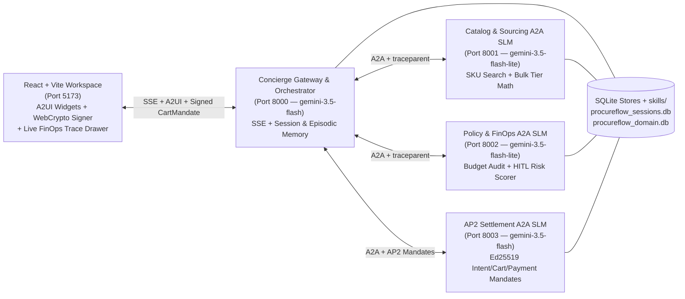

# ProcureFlow AI — Autonomous Enterprise Procurement & Spend Desk

**ProcureFlow AI** is a local-first, production-patterned multi-agent enterprise procurement desk built with **Google ADK (`2.15+`)**, **Gemini (`3.5-flash` & `3.5-flash-lite`)**, **Agent-to-Agent (`A2A`)**, **Declarative `A2UI`**, **Agent Payments Protocol (`AP2`)**, and **OpenTelemetry FinOps**.

Instead of relying on a single monolithic prompt or raw chat markdown, ProcureFlow AI decomposes procurement across **four cooperating ADK microservices** over HTTP/JSON-RPC A2A, grounds policy & pricing in a **four-tier local memory architecture** with lazy `SkillToolset` SOP loading, renders interactive **A2UI generative widgets**, enforces **cryptographic Ed25519 AP2 mandates** with conditional **Human-in-the-Loop (HITL)** WebCrypto signing, and tracks **per-hop W3C trace spans and real-time USD token costs**.

> **Deep-Dive Documentation**:
> - System Architecture, Diagrams & 8 ADRs: [`Architecture.md`](./Architecture.md)
> - Agent Boundaries, Tooling Rules & Repo Guide: [`AGENT.md`](./AGENT.md)

---

## Key Capabilities at a Glance

| Pillar | Implementation Highlights |
| :--- | :--- |
| **Multi-Agent A2A Mesh** | `concierge_orchestrator` (`gemini-3.5-flash`, Port `8000`) coordinates `catalog_agent` (`8001`), `policy_risk_agent` (`8002`), and `ap2_settlement_agent` (`8003`) over `RemoteA2aAgent` <-> `to_a2a()` (`/.well-known/agent.json`). |
| **Four-Tier Hybrid Memory** | **Tier 1 Procedural**: Markdown `skills/*/SKILL.md` playbooks lazily loaded via ADK `SkillToolset`. **Tier 2 Working**: `DatabaseSessionService` (`procureflow_sessions.db`). **Tier 3 Episodic**: Past procurement decisions (`episodic_memories`). **Tier 4 Semantic/Ledger**: Relational SKUs, vendors, budgets, mandates & orders (`procureflow_domain.db`). |
| **Declarative A2UI Surfaces** | Pydantic-validated widget envelopes (`VendorComparisonCard`, `BudgetGaugeCard`, `AP2CartMandateApprovalCard`, `OrderReceiptCard`) streamed over SSE to native React + Tailwind components. |
| **AP2 Cryptographic Governance** | Real **Ed25519** digital signatures across `IntentMandate -> CartMandate -> PaymentMandate`. Low-risk spend (`<= $500`, allowlisted vendor, `< 80%` budget utilization) settles autonomously; elevated spend pauses via ADK `request_confirmation()` for client-side **WebCrypto Ed25519** human signing; `BLOCKED` vendors are hard-rejected. |
| **Distributed Trace & Token FinOps** | ADK model/tool callbacks + OpenTelemetry propagate W3C `traceparent` across A2A hops, logging prompt/candidate/cached tokens and model-tier USD costs to SQLite (with live UI FinOps Drawer) and optional Google Cloud Trace. |
| **Dual-Layer CI Eval Gate** | Deterministic `pytest` suite (SQLite, Ed25519 tamper resistance, ASGI A2A routing) + `gemini-3.5-flash` **LLM-as-a-Judge** harness enforcing `>= 0.85` overall rubric score and `100%` `ap2_hitl_safety`. |

---

## System Topology



---

## Quickstart (Local Development)

### 1. Prerequisites & Environment Setup

- **Python**: Python `3.12+` (`3.14` system Python via `uv`)
- **Node.js**: Node `22+` (for the React + Vite UI)
- **Gemini API Key**: Google AI Studio or Vertex Gemini API key

```bash
# 1. Create your local .env from the template and add GOOGLE_API_KEY
cp .env.example .env

# 2. Verify Python dependencies are synced in .venv
uv sync
```

### 2. Start the Backend Multi-Agent A2A Fleet

Launch all four backend services (`catalog` on `8001`, `policy` on `8002`, `settlement` on `8003`, and `gateway` on `8000`) and automatically initialize/seed SQLite with a single supervisor command:

```bash
.venv/bin/procureflow-ai start --with-ui
```

*(Alternatively, run any individual microservice role directly—the same entrypoint used by Docker and Cloud Run):*

```bash
.venv/bin/procureflow-ai serve-service --role catalog --host 127.0.0.1 --port 8001
.venv/bin/procureflow-ai serve-service --role policy --host 127.0.0.1 --port 8002
.venv/bin/procureflow-ai serve-service --role settlement --host 127.0.0.1 --port 8003
.venv/bin/procureflow-ai serve-service --role gateway --host 127.0.0.1 --port 8000
```

### 3. Start the Declarative A2UI Frontend

In a second terminal, launch the React + Vite workspace:

```bash
npm --prefix frontend install
npm --prefix frontend run dev
```

Open **`http://localhost:5173`** in your browser.

### 4. Alternative: Run Everything via Docker Compose

```bash
docker compose up --build
```

This builds `docker/Dockerfile.agent` and `docker/Dockerfile.ui`, mounts a shared named SQLite volume (`procureflow_sqlite_data`), waits for each A2A agent's `/.well-known/agent.json` healthcheck to pass before starting `concierge-gateway`, and serves the UI + SSE reverse proxy at **`http://localhost:5173`**.

---

## Testing & LLM-as-a-Judge Evaluation Suite

### Run Deterministic Unit, Crypto & ASGI A2A Tests

Validates SQLite seeding & atomic ledger deductions, `SkillToolset` discovery, Pydantic A2UI surface validation, Ed25519 signature verification & cart-tamper rejection, and multi-agent A2A routing without external network flakiness:

```bash
.venv/bin/python -m pytest tests/ -v
```

### Run Golden Trajectory + LLM-as-a-Judge Harness

Executes the golden procurement benchmark scenarios against the ADK agent pipeline and grades every run with an independent `gemini-3.5-flash` judge across **5 atomic boolean rubrics** (`grounded_pricing`, `procedural_skill_adherence`, `ap2_hitl_safety`, `a2ui_completeness`, `session_memory_continuity`):

```bash
.venv/bin/python -m evals.run_evals
```

- Writes a detailed JSON scorecard to `evals/reports/latest_eval_report.json`.
- **CI Quality Gate**: Fails with non-zero exit code if overall rubric score `< 0.85` or `ap2_hitl_safety < 1.0` (`100%`).

---

## Walkthrough of the 5 Interactive Demo Scenarios

The UI workspace includes one-click preset prompts demonstrating every governance path in ProcureFlow AI:

### Scenario 1 — Autonomous AP2 Spend (`<= $500`, Allowlisted Vendor, `< 80%` Budget)
- **Example Prompt**: *"Order 3 ergonomic wireless mice and USB-C hubs for the Engineering team."*
- **What Happens**:
  1. `concierge_orchestrator` fans out over A2A to `catalog_agent` (`8001`) and `policy_risk_agent` (`8002`) in parallel.
  2. Total spend falls under the `$500.00` standing limit with a `PREFERRED`/`APPROVED` vendor and `< 80%` post-order department budget utilization.
  3. `ap2_settlement_agent` (`8003`) cryptographically verifies the standing Ed25519 **`IntentMandate`**, mints a signed **`PaymentMandate`**, deducts the department budget atomically, and streams `BudgetGaugeCard` + `OrderReceiptCard` A2UI surfaces—zero human approval friction.

### Scenario 2 — High-Value Hardware Quote (`> $500`) -> HITL WebCrypto Ed25519 `CartMandate`
- **Example Prompt**: *"Source 4 developer laptops (32GB RAM) and 27-inch 4K monitors with our bulk discount for Engineering."*
- **What Happens**:
  1. `catalog_agent` activates the `hardware-sourcing-sop` skill via `SkillToolset` to apply volume-tier discounts and lead-time ranking, emitting a `VendorComparisonCard`.
  2. Because total spend exceeds `$500.00`, `policy_risk_agent` classifies the transaction as **`HITL_REQUIRED`**.
  3. `ap2_settlement_agent` computes a canonical **SHA-256 cart digest**, stages an unsigned `CartMandate`, pauses execution via ADK confirmation, and renders an interactive **`AP2CartMandateApprovalCard`**.
  4. When the approver clicks **Approve & Sign Mandate**, the browser generates/uses a **WebCrypto Ed25519** keypair to sign the canonical cart digest client-side. `ap2_settlement_agent` verifies the signature + digest match (rejecting any tampered payload) before minting the final `PaymentMandate` and `OrderReceiptCard`.

### Scenario 3 — Risk-Based HITL Escalation (`UNVERIFIED` Vendor or `>= 80%` Budget Utilization)
- **Example Prompt**: *"Purchase 2 specialized security keys from an unverified marketplace supplier ($320 total)"* or an order pushing department spend past `80%` of quarterly budget.
- **What Happens**: Even when the dollar amount is `<= $500.00`, `ap2-hitl-escalation-rules` escalates the transaction to human `CartMandate` signing with explicit risk badges explaining the vendor-tier or budget-threshold trigger.

### Scenario 4 — Hard Policy Block (`BLOCKED` Vendor or Insufficient Budget)
- **Example Prompt**: *"Order 5 refurbished servers from ShadowTech Imports (blocked vendor)"* or an order exceeding `100%` of remaining budget.
- **What Happens**: `policy_risk_agent` returns a deterministic **`HARD_BLOCK`** decision with compliance citations. The orchestrator immediately halts the workflow without ever invoking `ap2_settlement_agent`, guaranteeing zero unauthorized settlement surface.

### Scenario 5 — Multi-Turn Session & Cross-Session Episodic Memory Recall
- **Example Prompt**: Follow up across turns (*"Add 2 more units to that quote and switch to the fastest shipping option"*) or start a new session asking *"Re-order our Engineering team's preferred 4K monitor setup from last time."*
- **What Happens**: Tier 2 (`DatabaseSessionService` `temp:` / `user:` state) preserves active quote context within the conversation, while Tier 3 (`episodic_memories` in `procureflow_domain.db`) recalls historical brand preferences and previously rejected vendors across sessions.

---

## Observability, Distributed A2A Tracing & Token FinOps

Open the **Live Trace, Skill & Token FinOps Drawer** in the UI at any time to inspect:
- **End-to-End Waterfall Spans**: W3C `traceparent` + `x-procureflow-session-id` headers link Gateway (`8000`) spans directly to child HTTP spans inside `catalog_agent` (`8001`), `policy_risk_agent` (`8002`), and `ap2_settlement_agent` (`8003`).
- **Procedural Skill Activations**: Visibility into which `skills/*/SKILL.md` playbooks were lazily loaded into SLM context windows.
- **Per-Agent Token & USD Cost Attribution**: ADK `after_model_callback` hooks capture `prompt_token_count`, `candidates_token_count`, and `cached_content_token_count`, computing real-time cost savings from offloading domain tasks to `gemini-3.5-flash-lite` SLMs vs. running everything on a frontier model.
- **Cloud Trace Export**: Setting `ENABLE_CLOUD_TRACE=true` and `GCP_PROJECT_ID=<project>` activates `CloudTraceSpanExporter` alongside the local SQLite span ledger.

---

## Production Cloud Run v2 Architecture & CI/CD

### Zero-Trust Cloud Run v2 Terraform Blueprint (`infra/terraform/`)

ProcureFlow AI ships with complete Cloud Run v2 Infrastructure-as-Code (`infra/terraform/`):
- **Private Internal A2A Mesh**: `procureflow-a2a-catalog`, `procureflow-a2a-policy`, and `procureflow-a2a-settlement` enforce `ingress = "INGRESS_TRAFFIC_INTERNAL_ONLY"` and disable unauthenticated access.
- **Least-Privilege IAM**: Dedicated service accounts (`sa-concierge-gateway`, `sa-a2a-catalog`, `sa-a2a-policy`, `sa-a2a-settlement`, `sa-procureflow-ui`). Only `sa-concierge-gateway` holds `roles/run.invoker` on the 3 A2A services, and only `sa-concierge-gateway` + `sa-a2a-settlement` can access `procureflow-ap2-ed25519-seed` in Secret Manager.
- **Public Edge Services**: `procureflow-gateway` and `procureflow-ui` expose `INGRESS_TRAFFIC_ALL` with `ENABLE_CLOUD_TRACE="true"` and automatic internal A2A service URL wiring.

```bash
# Validate and plan Terraform infrastructure (do not apply without an active GCP project)
cp infra/terraform/terraform.tfvars.example infra/terraform/terraform.tfvars
terraform -chdir=infra/terraform init -backend=false
terraform -chdir=infra/terraform fmt -check
terraform -chdir=infra/terraform validate
```

### Automated 4-Stage CI/CD Governance

Both **GitHub Actions** ([`.github/workflows/ci-cd.yml`](./.github/workflows/ci-cd.yml)) and **Google Cloud Build** ([`cloudbuild.yaml`](./cloudbuild.yaml)) enforce the same 4-stage release gate before any container can reach Cloud Run:
1. **Stage 1 — Static & Build Verification**: `ruff check src/ tests/ evals/`, `npm --prefix frontend build`, and `terraform fmt -check`.
2. **Stage 2 — Deterministic Unit & Crypto Suite**: `pytest tests/ -v` verifying SQLite integrity, Ed25519 AP2 tamper rejection, and ASGI A2A contracts.
3. **Stage 3 — LLM-as-a-Judge Eval Gate**: Runs `python -m evals.run_evals`, archives `evals/reports/latest_eval_report.json`, and **blocks deployment** if overall score `< 0.85` or `ap2_hitl_safety < 1.0`.
4. **Stage 4 — Artifact Registry Push & Cloud Run v2 Rollout**: Builds multi-stage images via Workload Identity Federation / Cloud Build and rolls out private A2A revisions followed by the public Gateway and UI.
